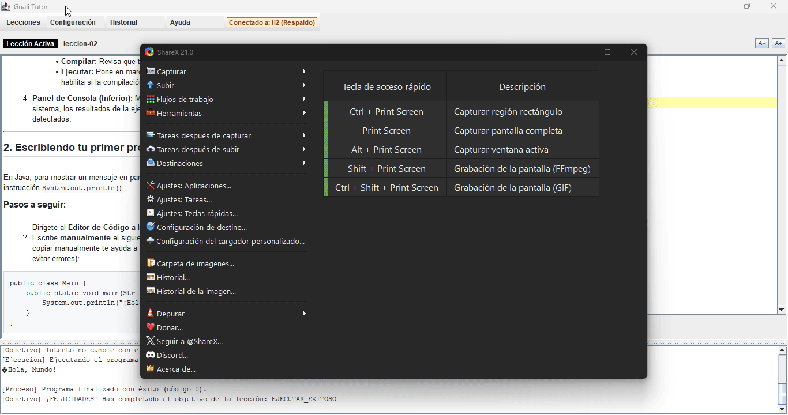
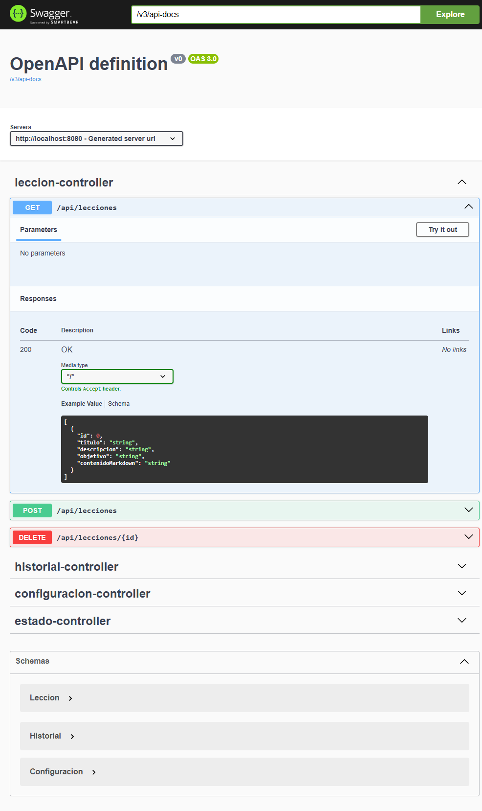

# API REST — Sistema de Gestión de Lecciones (Back-End)


Servicio Web Back-End desarrollado en Java con Spring Boot que expone una arquitectura API REST para administrar de forma remota el catálogo de lecciones, la configuración del JDK e historial de sesiones para el cliente Java Swing.

> Proyecto Universitario | Desarrollado para la asignatura de Programación 2 (Facultad de Ingeniería, Universidad Mariano Gálvez).

---

## Descripción y Propósito del Sistema

**Aprende con Guali** es un entorno interactivo de aprendizaje diseñado para ayudar a estudiantes a practicar y resolver lecciones de programación en Java de manera guiada. 

### ¿Qué hace el programa?
* **Gestión de Lecciones:** Permite cargar, visualizar, importar y eliminar ejercicios de programación con su respectiva descripción, objetivo y código inicial de plantilla.
* **Entorno de Compilación y Ejecución:** Integra un motor que toma el código escrito por el estudiante, lo compila utilizando la ruta del JDK configurada y evalúa si la solución es correcta o contiene errores.
* **Seguimiento del Progreso (Historial):** Registra automáticamente los intentos del estudiante, guardando la fecha, hora y resultado obtenido (Completada / Pendiente) para llevar un control del aprendizaje.
* **Arquitectura Cliente-Servidor:** El cliente (interfaz gráfica Java Swing) se comunica mediante peticiones HTTP asíncronas con este servicio Back-End (Spring Boot), garantizando la separación entre la interfaz de usuario y la persistencia de datos.

---

## Demostración y Pruebas del Sistema

| Interfaz Gráfica (Cliente Java Swing) | Documentación de la API REST (Swagger UI) |
| :---: | :---: |
|  |  |

---

## Especificaciones Técnicas y Endpoints (CRUD)

El backend expone endpoints RESTful en formato JSON para la manipulación y persistencia de datos:

### Lecciones (`/api/lecciones`)
* `GET /api/lecciones` — Obtener el catálogo completo de lecciones.
* `POST /api/lecciones` — Importar / registrar una nueva lección en la base de datos.
* `DELETE /api/lecciones/{id}` — Eliminar una lección persistida.

### Historial de Sesiones (`/api/historial`)
* `GET /api/historial` — Consultar el registro de intentos y estados (Completada/Pendiente).
* `POST /api/historial` — Registrar el resultado de ejecución/compilación de una lección.

### Configuración (`/api/configuracion`)
* `GET /api/configuracion/jdk` — Obtener la ruta persistida del JDK.
* `PUT /api/configuracion/jdk` — Actualizar la ruta del JDK en el sistema.

---

## Arquitectura y Desglose de Atribución del Código

El proyecto se construyó bajo una arquitectura MVC / Multicapa (Controllers, Services, Repositories, DTOs). La responsabilidad del código se distribuye exactamente de la siguiente manera:

| Componente | Origen / Atribución | Código y Lógica Específica Desarrollada |
| :--- | :--- | :--- |
| **Lógica de Negocio y Ensamblado** | **Desarrollo propio (Mi rol)** | • Algoritmo de evaluación de lecciones y toma de decisiones para marcar estados (Completada / Pendiente).<br>• Lógica para la creación, registro e importación de lecciones.<br>• Creación y mapeo de los controladores REST (`@RestController`) y endpoints HTTP.<br>• Integración y comunicación del cliente Java Swing con los endpoints de la API REST.<br>• Ensamblado general de las capas del sistema y estructuración del flujo de datos. |
| **Proyecto Base y Recursos** | **Cátedra / Profesor** | • Estructura base del cliente gráfico Java Swing (Front-End inicial).<br>• Archivo ejecutable `guali-dev.jar` para invocación de compilación/ejecución.<br>• Requerimientos de la interfaz gráfica e insumos del laboratorio. |
| **Soporte de Inteligencia Artificial** | **Herramientas de IA** | • Generación del código repetitivo (*boilerplate*) para clases de configuración.<br>• Aceleración en el armado del esquema de especificación OpenAPI / Swagger.<br>• Optimización de sintaxis en métodos auxiliares repetitivos. |

> **Nota de Arquitectura y Legado:** El paquete `com.guali.tutor.db` contiene las clases DAO y de conexión JDBC desarrolladas originalmente para la Fase 1 del proyecto. Se mantienen conservadas  como evidencia de la evolución del sistema hacia la arquitectura API REST actual.

---

## Gestión de Base de Datos y Tolerancia a Fallos (Fallback)

La API REST implementa una estrategia de conexión híbrida para garantizar la disponibilidad del servicio y evitar pérdida de información:

* **Base de Datos Principal (MariaDB):** El sistema se conecta por defecto a una instancia de MariaDB para producción y persistencia general.
* **Mecanismo de Fallback (H2 Persistente):** Si la conexión a MariaDB se interrumpe o falla, la aplicación conmuta automáticamente a H2 Database.
* **Persistencia Asegurada (No Volátil):** H2 está configurado en modo archivo/disco, lo que asegura que los datos registrados en modo offline no se borren al reiniciar la aplicación.

---

## Cómo Ejecutar el Proyecto

### Requisitos Previos
* **Java JDK 21 o superior** (Recomendado JDK 25).
* **IntelliJ IDEA** (Community o Ultimate).
* **MariaDB / MySQL** (Opcional, el sistema incluye respaldo automático a H2 en caso de no estar activa).

---

### Pasos para la Primera Ejecución

1. **Clonar el repositorio:**
   ```bash
   git clone [https://github.com/tu-usuario/nombre-del-repo-api.git](https://github.com/tu-usuario/nombre-del-repo-api.git)
   ```
2. **Abrir en IntelliJ IDEA:**
   * Abre IntelliJ IDEA y selecciona **Open**.
   * Selecciona la carpeta raíz del proyecto importado.

3. **Cargar las Dependencias de Maven:**
   * Abre la pestaña de **Maven** en el lateral derecho de IntelliJ.
   * Haz clic en el ícono de **Reload All Maven Projects** (las dos flechas en círculo) para descargar todas las librerías de Spring Boot.
   * *Si abres el archivo `pom.xml` dentro de `guali-backend`, también puedes hacer clic derecho ➔ `Maven` ➔ `Reload Project`.*

4. **Iniciar el programa:**
   * Navega a la ruta: `guali-tutor/src/main/java/com/guali/guali_tutor/Iniciar_Programa.java`.
   * Haz clic derecho sobre el archivo y presiona **Run 'Iniciar_Programa'**.

---

## Solución a Problemas Frecuentes al Clonar (Troubleshooting)

Si al abrir el proyecto en IntelliJ el código muestra líneas rojas o errores de compilación, aplica las siguientes soluciones:

### 1. ¿El código muestra errores `Cannot resolve symbol 'SpringBootApplication'`?
* **Causa:** IntelliJ no ha vinculado las librerías del módulo `guali-backend`.
* **Solución:** 
  1. Ve a la pestaña **Maven** (derecha).
  2. Haz clic derecho sobre `guali-backend` y selecciona **Reload Project**.
  3. Si persiste, abre la terminal en IntelliJ y ejecuta:
     ```bash
     mvn clean install -U
     ```
### 2. Error de Incompatibilidad de JDK / Language Level
* **Causa:** La versión global de Java de tu IntelliJ no coincide con el módulo del backend.
* **Solución:**
  1. Presiona `Ctrl + Alt + Shift + S` (o ve a `File` ➔ `Project Structure`).
  2. En **Project**, verifica que el SDK sea Java 21 o 25.
  3. En **Modules**, selecciona `guali-backend` y cambia el **Language Level** a la versión correspondiente del SDK (Java 21/25).

### 3. Error de Conexión a la Base de Datos (MariaDB Connection Refused)
* **Comportamiento Normal:** No te preocupes si no tienes instalado MariaDB o si el servicio está apagado.
* **Mecanismo Automático:** El backend detectará la ausencia de MariaDB y mostrará en consola:
  ```text
  >>> MARIADB NO DISPONIBLE... ACTIVANDO H2 (RESPALDO DISCO)