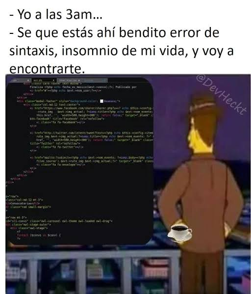

# Tutorial 3

# Identificando Errores de Sintaxis en Java

En la lección anterior aprendiste que Java es un lenguaje estricto. El compilador necesita que escribas las instrucciones con reglas de sintaxis exactas; si cometes una pequeña falta (como olvidar un punto y coma o cerrar una comilla), el código no se traducirá y obtendrás un **error de compilación**.

En este tutorial aprenderás a perderle el miedo a los mensajes de error y a utilizarlos a tu favor para corregir tu código.

---

## 1. ¿Qué es un error de compilación?

Un **error de compilación** ocurre cuando el compilador analiza tu texto en Java y encuentra algo que viola las reglas del lenguaje.

A diferencia de un error de ejecución (donde el programa se rompe mientras corre), un error de compilación **impide por completo que el programa se genere o ejecute**.

### Los errores más comunes en principiantes:
1. **Omitir el punto y coma `;`** al final de una instrucción.
2. **No cerrar paréntesis `()` o llaves `{ }`.**
3. **No cerrar comillas `"..."`** al escribir un texto.
4. **Escribir mal las palabras clave** (ej. escribir `System.Out.println` o `string` en minúscula). Java distingue estricta y rigurosamente entre mayúsculas y minúsculas (*case-sensitive*).

---

## 2. Cómo leer un mensaje de error en la Consola

Cuando presionas el botón **Compilar** y existe un problema, la **Consola (Panel Inferior)** te dará pistas cruciales:

```text
Main.java:5: error: ';' expected
        System.out.println("Hola Mundo")
                                        ^
1 error