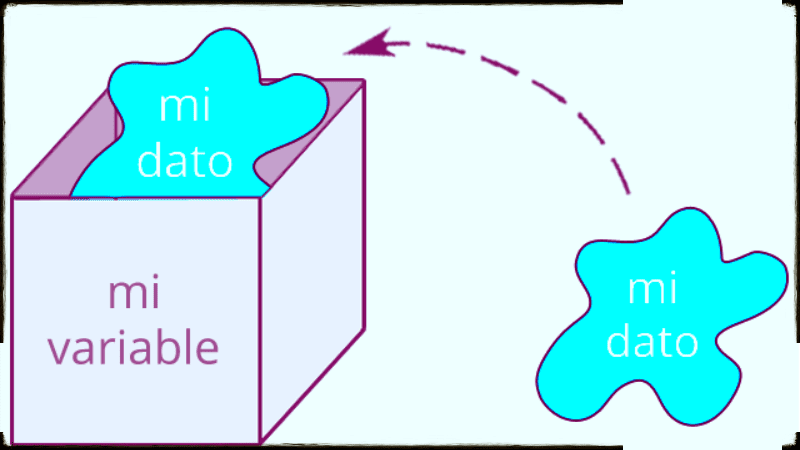

# Tutorial 4

# Variables y Tipos de Datos en Java

En esta lección aprenderás cómo almacenar y organizar información en la memoria de la computadora para poder reutilizarla en tus programas.

---

## 1. ¿Qué es una variable?

Una **variable** es como un contenedor etiquetado en la memoria de la computadora. En ella puedes guardar un valor (como un nombre o un número) para consultarlo o modificarlo más adelante.

En Java debes **indicar obligatoriamente qué tipo de dato guardará la variable** antes de usarla. Esto se conoce como un lenguaje fuertemente tipado.

---

## 2. Tipos de Datos Primitivos Básicos

Java incluye varios tipos de datos predefinidos. Los más utilizados a nivel básico son:

| Tipo | Qué almacena | Ejemplo de valor |
| :--- | :--- | :--- |
| `String` | Texto entre comillas dobles | `"Juan"`, `"Guatemala"` |
| `int` | Números enteros (sin decimales) | `25`, `-10`, `2026` |
| `double` | Números con punto decimal | `15.50`, `3.1416` |
| `boolean` | Valores lógicos (verdadero o falso) | `true`, `false` |

---

## 3. Reglas para declarar y nombrar variables

Para crear una variable en Java se sigue la estructura obligatoria:

`TipoDato nombreVariable = valor;`

### Reglas indispensables:
* **Asignación de tipos:** No puedes guardar un texto entre comillas en una variable de tipo `int`, ni un número sin comillas en un `String`.
* **Nombres válidos:** Deben empezar en minúscula usando la convención *camelCase* (ej. `nombreUsuario`, `notaFinal`).
* **Concatenación:** Para unir variables con texto dentro de un `System.out.println()`, se utiliza el operador de suma `+`.

---

## 4. Instrucciones para la Práctica

A continuación se presenta el código completo. Tu objetivo es escribirlo manualmente en el editor y compilarlo sin errores.

1. Dirígete al **Editor de Código** a la derecha.
2. Escribe **manualmente** el siguiente código completo:

```java
public class Main {
    public static void main(String[] args) {
        // Declaración e inicialización de variables
        String nombre = "Alex";
        int edad = 19;
        double notaFinal = 92.5;
        boolean aprobado = true;

        // Impresión de datos concatenando con el operador '+'
        System.out.println("Estudiante: " + nombre);
        System.out.println("Edad: " + edad + " años");
        System.out.println("Calificación: " + notaFinal);
        System.out.println("¿Aprobó el curso?: " + aprobado);
    }
}