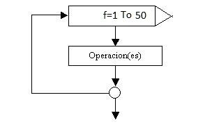

# Tutorial 7

# Automatización y Repetición con Bucles (for y while)

En programación, con frecuencia necesitamos realizar una misma tarea múltiples veces (por ejemplo, procesar una lista de estudiantes, contar del 1 al 100 o repetir una operación hasta que el usuario decida salir). 

Los **bucles** o **ciclos** nos permiten repetir un bloque de código automáticamente sin necesidad de duplicar líneas.

---

## 1. Reglas y Conceptos Clave

Java cuenta con dos tipos principales de bucles:

* **El Bucle `for`:** Se utiliza cuando **sabemos de antemano cuántas veces** queremos repetir una instrucción. Se compone de tres partes principales:
  1. *Inicialización:* `int i = 1;` (crea la variable contador).
  2. *Condición:* `i <= 5;` (mientras esto sea verdadero, el bucle continúa).
  3. *Incremento:* `i++` (aumenta el valor del contador en 1 al finalizar cada vuelta).

* **El Bucle `while`:** Se utiliza cuando **no sabemos exactamente cuántas repeticiones haremos**, ya que depende de que una condición siga siendo verdadera.

---

## 2. Instrucciones para la Práctica

A continuación escribirás un programa que utiliza ambos tipos de bucles para mostrar una secuencia numérica y una cuenta regresiva en el **Panel de Consola**.

1. Dirígete al **Editor de Código** a la derecha.
2. Escribe **manualmente** el siguiente código Java completo:

```java
public class Main {
    public static void main(String[] args) {
        System.out.println("--- Ejemplo 1: Bucle FOR ---");
        // Imprime los números del 1 al 5
        for (int i = 1; i <= 5; i++) {
            System.out.println("Número actual: " + i);
        }

        System.out.println("\n--- Ejemplo 2: Bucle WHILE ---");
        // Cuenta regresiva del 3 al 1
        int contador = 3;
        while (contador > 0) {
            System.out.println("Cuenta regresiva: " + contador);
            contador--; // Resta 1 al contador
        }

        System.out.println("\n¡Bucles ejecutados con éxito!");
    }
}