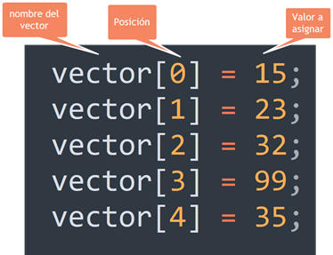

# Tutorial 9

# Manejo de Colecciones de Datos con Arrays

Hasta ahora, cada variable que declarabas solo podía guardar un único valor a la vez. Cuando necesitas trabajar con múltiples datos del mismo tipo (por ejemplo, una lista de 5 notas o los nombres de los días de la semana), utilizar **Arrays** (o arreglos) es la mejor opción.

Un **Array** es una estructura de datos de tamaño fijo que almacena una colección de elementos del mismo tipo bajo un solo nombre.

---

## 1. Reglas y Conceptos Clave

Para trabajar con arrays en Java, debes dominar los siguientes puntos:

* **Índices basados en Cero (Zero-based):** Los elementos dentro de un array se organizan por posiciones numéricas llamadas **índices**. La primera posición siempre es la posición `0`, la segunda es la `1`, y así sucesivamente.
* **Declaración e Inicialización:**
  ```java
  // Sintaxis rápida especificando los elementos:
  int[] numeros = {10, 20, 30, 40, 50};
  
## 2. Instrucciones para la Práctica
Sigue estos pasos dentro de la interfaz de la aplicación para completar la lección:

1. Dirígete al Editor de Código en el panel central derecho.

2. Escribe manualmente el siguiente programa Java completo:

```java
public class Main {
    public static void main(String[] args) {
        System.out.println("--- Procesando Array de Calificaciones ---");

        // Declaración e inicialización del array de notas
        int[] notas = {85, 90, 78, 92, 88};

        int suma = 0;

        // Recorriendo el array con un bucle for
        for (int i = 0; i < notas.length; i++) {
            System.out.println("Nota en posición " + i + ": " + notas[i]);
            suma += notas[i]; // Acumulando la suma
        }

        // Calculando el promedio
        double promedio = (double) suma / notas.length;

        System.out.println("----------------------------------------");
        System.out.println("Suma total: " + suma);
        System.out.println("Promedio general: " + promedio);
    }
}