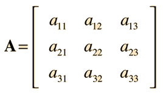

# Tutorial 10

# Arrays Bidimensionales (Matrices)

En la lección anterior aprendiste a almacenar datos en una sola dimensión (listas). Sin embargo, en programación es habitual encontrarnos con información que se organiza en **filas y columnas**, como una tabla de Excel, un tablero de ajedrez o una cuadrícula de píxeles. Para estos casos utilizamos **Arrays Bidimensionales** o **Matrices**.

Una matriz en Java es esencialmente un "array de arrays".

---

## 1. Reglas y Conceptos Clave

Para comprender y trabajar con matrices en Java, ten en cuenta las siguientes reglas:

* **Estructura de Filas y Columnas:** Los datos se ubican mediante dos índices entre corchetes: `matriz[fila][columna]`.
  * El primer índice representa la **Fila** (línea horizontal).
  * El segundo índice representa la **Columna** (línea vertical).
  * Ambas posiciones comienzan a contarse desde `0`.
* **Declaración e Inicialización:**
  ```java
  // Matriz de 2 filas y 3 columnas con valores asignados directamente:
  int[][] matriz = {
      {1, 2, 3}, // Fila 0
      {4, 5, 6}  // Fila 1
  };

## 2. Instrucciones para la Práctica
Sigue estos pasos dentro de la interfaz de la aplicación para completar la lección:

1. Dirígete al Editor de Código en el panel central derecho.

2. Escribe manualmente el siguiente programa Java completo:

```java
public class Main {
    public static void main(String[] args) {
        System.out.println("--- Recorriendo una Matriz de 3x3 ---");

        // Declaración de una matriz de 3 filas x 3 columnas
        int[][] matriz = {
            {10, 20, 30},
            {40, 50, 60},
            {70, 80, 90}
        };

        // Recorrido con bucles anidados
        for (int fila = 0; fila < matriz.length; fila++) {
            for (int columna = 0; columna < matriz[fila].length; columna++) {
                System.out.print("[" + matriz[fila][columna] + "] ");
            }
            // Salto de línea al terminar cada fila para darle formato de tabla
            System.out.println();
        }

        System.out.println("-------------------------------------");
        System.out.println("Acceso directo a Fila 1, Columna 2: " + matriz[1][2]);
    }
}